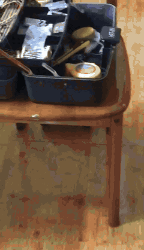
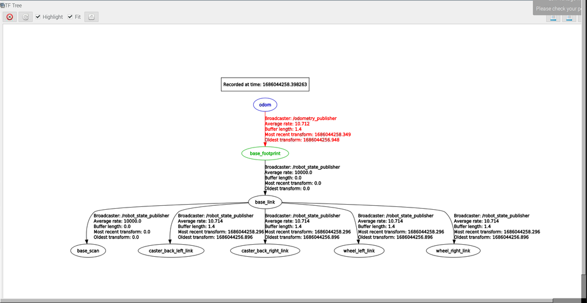
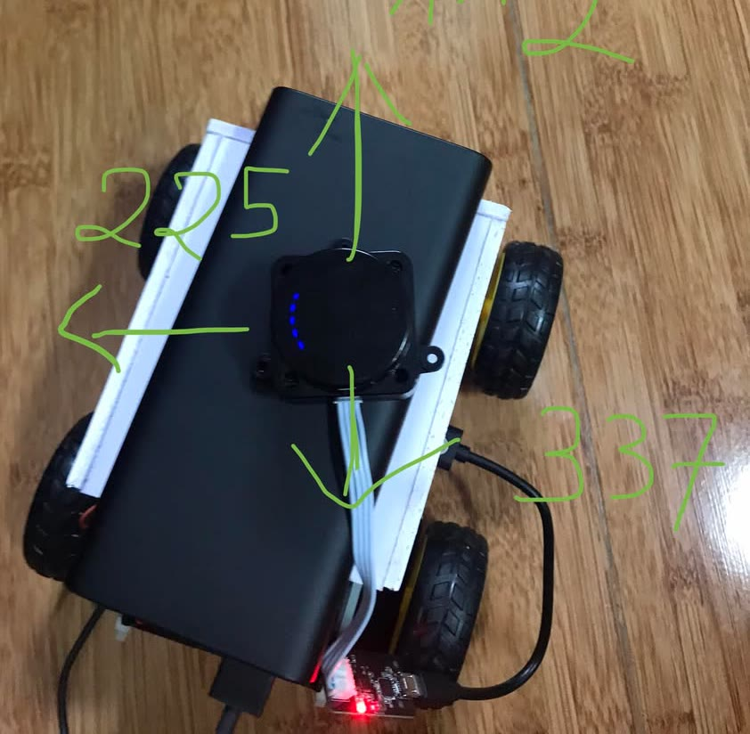
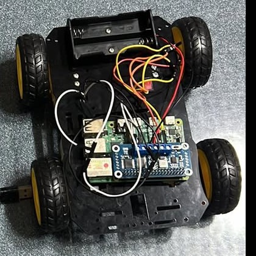
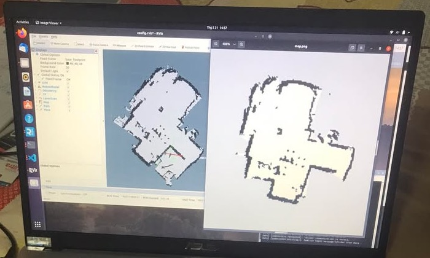

# HK222 LiDAR robot car



A small ROS 1 robot car, built by a team of 4 students for the Multidisciplinary Project (HK222 semester, Jan to Jun 2023) at Ho Chi Minh City University of Technology. A Raspberry Pi 4 turns `/cmd_vel` into motor PWM, counts wheel ticks into `/odom`, and publishes `/scan` from an LD19 2D LiDAR. A laptop on the same ROS master runs RViz, gmapping, an EKF, AMCL and move_base. The real car mapped a multi-room home with SLAM and localized itself in that map with AMCL. Autonomous goal navigation worked in simulation, but on the real car it was our main limitation: small heading errors from a cheap IMU added up every second, the pose drifted, and the car missed its goals (see [the limitation](#the-limitation-imu-drift-and-goal-navigation)). The clip above is the first mapping run, 31 May 2023: the car on the floor, and the map growing live on the laptop. The project was graded 9.5/10. The real work was a 5-week sprint, from the day I paid for a ROS course to the defense (see [timeline](#timeline-a-5-week-sprint)).

The plan started as "plan B". We wanted to borrow a TurtleBot3. That did not work out, so we rebuilt a TurtleBot3-Burger-like robot ourselves from a borrowed Pi 4, a borrowed LD19 and cheap parts. Our instructor's first question was a good one: a TurtleBot3 already has a LiDAR, so what will you add?

This is a fork of [Quoc1610/Multidisciplinary-Project---HK222](https://github.com/Quoc1610/Multidisciplinary-Project---HK222) at its 7 June 2023 snapshot. The code is unchanged. This README, `assets/` and `docs/` were added later. The commits were pushed by two teammates, Quốc ([Quoc1610](https://github.com/Quoc1610)) and Bảo ([DerpLEL](https://github.com/DerpLEL)), but the work was shared across the team, and I led it (see [team](#team)). The IMU and EKF work from the last week (8 to 11 June) was never pushed, so this snapshot does not have it (see [the limitation](#the-limitation-imu-drift-and-goal-navigation)).

## timeline: a 5-week sprint

The semester started in January, but our first months were slow. We tried setups, watched tutorials and got a first demo running in simulation, with little real progress. The real work started on 11 May 2023, when I paid for The Construct and took its ROS courses properly. The defense was 5 weeks later, on 14 June.

Before the sprint, 27 March to 3 May: ROS tutorials, a ROS install in Docker that failed on the Pi's Raspbian, the move to Ubuntu 20.04 and ROS Noetic, and a first goal-navigation demo in simulation (the clips below).

The sprint:

- 11 May: paid for one month of The Construct. ROS Basics from 11 to 16 May, then ROS Navigation from 13 May to 7 June.
- 15 May, 4 days in: the real car drives from `/cmd_vel`.
- 23 May: keyboard drive, right after our final exams (about 17 to 21 May).
- 31 May, 3 weeks in: first SLAM map of a real home.
- 6 June: wheel odometry and the full TF tree.
- 10 to 11 June: IMU on an Arduino Mega, EKF fusion, gmapping of the whole home, AMCL localization in the saved map, and the first autonomous goal runs with move_base in that map. The goal runs did not reach their targets reliably, and we have no recording of them.
- 14 June: defense. 19 June: graded 9.5/10.

## videos

**Real car, 31 May 2023 (41 s).** The first SLAM run in a real home: the car on the floor, and the map growing live in RViz.

https://github.com/user-attachments/assets/c437c4fb-16fb-42c2-aaeb-af2eb864be6e

**Real car, 11 June 2023 (1:42).** Screen recording: gmapping of the whole home.

https://github.com/user-attachments/assets/6bcce406-377d-42bd-91e8-38ab99017653

**Real car, 11 June 2023 (1:28).** Screen recording: the AMCL particle cloud converging on the saved map.

https://github.com/user-attachments/assets/4e3fcb1e-cb3f-4696-a302-cf12f611de0b

**Simulation, 3 May 2023 (55 s).** RViz: set the start pose, click a goal, and move_base drives there.

https://github.com/user-attachments/assets/90d085d8-1d82-41bd-a2c9-a9c433932256

**Simulation, 3 May 2023 (26 s).** Obstacle avoidance with our own code on top of AMCL.

https://github.com/user-attachments/assets/dd295810-6b95-4230-afa0-49415f63548f

The same files are in [assets/videos](assets/videos).

## how it fits together

```
Raspberry Pi 4 (ROS Noetic)                        laptop (Ubuntu 20.04, ROS Noetic)
  ld19.launch          -> /scan                       rviz
  Arduino + rosserial  -> /left_ticks /right_ticks    gmapping   -> /map        (mapping)
  odom_tick.py         -> /odom, TF odom->base        EKF: wheel odom + IMU
  Arduino Mega         -> MPU6050 IMU                 map_server + AMCL -> TF map->odom
  move_with_cmd_vel.py <- /cmd_vel                    move_base  -> /cmd_vel
       -> pca9685_node -> motor HAT -> 2 motors
```

The Pi runs only the hardware nodes. Mapping, localization, planning and RViz run on the laptop.



The TF tree on the real robot, 6 June 2023: `odom -> base_footprint -> base_link`, then the LiDAR frame, two wheels and two rear casters. Odometry comes in at about 10.7 Hz.

## hardware

| part | what |
|---|---|
| computer | Raspberry Pi 4 Model B 2 GB (borrowed), plus a laptop for the stack |
| LiDAR | LDRobot LD19, 2D, 360°, 0.02 to 12 m, on `/dev/ttyUSB0` at 230400 baud (borrowed) |
| motors | Waveshare Motor Driver HAT (PCA9685 + TB6612FNG), DC gear motors, left and right sides driven separately (differential drive) |
| encoders | slotted optical encoder modules, 20 ticks per revolution, read by an Arduino over rosserial at 57600 baud |
| IMU | MPU6050 (3-axis gyro + 3-axis accelerometer, no magnetometer) on an Arduino Mega |
| size | wheel radius 3.3 cm, wheel track about 0.15 m, top speed about 0.71 m/s |
| power | a 10,000 mAh power bank |

 

## files of the repo

There are two catkin workspaces, one per machine. Most folders inside them are upstream ROS packages that we copied in. Our own code is in a few places:

1. [src_sbc/test](src_sbc/test): the Pi side. `motor_driver.py` and `move_with_cmd_vel.py` turn `/cmd_vel` into a turn radius, then into PWM for each side on the PCA9685. The `MotorDriver` class is adapted from The Construct's "Create Your First Robot" course, with our wheel distance and the GPIO calls replaced by a PCA9685 topic. `odom_tick.py` integrates left and right ticks into `/odom` and the `odom -> base_footprint` transform at 10 Hz. `launch/total.launch` starts all of the Pi nodes at once.
2. [src_sbc/rosbots](src_sbc/rosbots) and [src_PC/rosbots](src_PC/rosbots): the URDF/xacro model of the car, meshes, the RViz config and the Gazebo spawn launch. `src_PC/rosbots/maps` holds the maps we saved.
3. [src_PC/robot_local/tesla_tools](src_PC/robot_local/tesla_tools): the laptop side. Launch files for gmapping, Hector mapping, AMCL, EKF and move_base, plus costmap and planner configs. These started from a The Construct exercise for the Summit XL robot. We changed the frames and the odometry model for our car, but not everything (see known issues).
4. [src_PC/pack](src_PC/pack) and `src_sbc/test/src/test_maze.py`, `robot_control_class.py`, `testing.py`: course scaffolds from The Construct that we used while learning ROS.

Everything else is upstream: `ldlidar_stl_ros` (LD19 driver), `pwm_pca9685`, `rosserial`, `serial`, `slam_gmapping`, `openslam_gmapping`, `hector_slam`, `robot_localization`, `robot_pose_ekf`, `IMU_TO_ROS`, `teleop_twist_keyboard`, `gazebo_ros_pkgs`, and others. `raspicam_node` and `image_pipeline` are vendored too, but no camera was ever mounted on the car.

## run

We have not run this since June 2023, so treat this as a record and not as a tested recipe. This is the run list from our team chat on 11 June 2023, the day we recorded the localization demo. The Pi is the ROS master.

On the Pi:

```bash
roscore
roslaunch test total.launch
```

On the laptop:

```bash
roslaunch rosbots rviz.launch
roslaunch tesla_tools start_amcl_localization.launch
roslaunch tesla_tools start_ekf_localization.launch
roslaunch tesla_tools move_base_map.launch
```

To make a new map instead, run `roslaunch tesla_tools start_gmapping.launch` on the laptop and drive the car with `teleop_twist_keyboard`.

## results



31 May 2023: the first full SLAM map of a real home. RViz with the live map is on the left, the saved `map.png` is on the right. We drove the car by keyboard with the LiDAR and a backup battery taped on top.

We dropped camera obstacle detection early. We started training a YOLOv3 (Darknet) model on Colab, then chose LiDAR-based avoidance: for a 2D LiDAR robot it was enough, and object detection was overkill for our deadline.

## the limitation: IMU drift and goal navigation

The hardware changed late. On 8 June the IMU code was not in yet. On 9 June we bought an Arduino Mega with more memory to run the IMU next to the encoders, and on 10 June I wired the MPU6050 and the encoders to it. On 11 June the EKF ran in the stack, fusing the wheel odometry with the IMU, under AMCL and move_base. That code lived on the Pi and the laptop and was never pushed, which is why `ekf_localization.yaml` in this snapshot still has the IMU lines commented out.

Mapping and localization worked. Autonomous goal navigation on the real car did not work reliably, and the main cause was heading drift from gyro bias. The MPU6050 is a low-cost consumer MEMS IMU with no magnetometer, so the only way to get yaw is to integrate the gyro rate. Any small bias in that rate is integrated too: each second adds a small error, and the heading error grows the longer the car runs. This is the standard failure of gyro-only heading in dead reckoning, and robotics texts describe it with two numbers: bias instability (slow drift of the bias, in °/h) and angle random walk (integrated noise). Cheap MEMS gyros sit at the poor end of both. The MPU6050 bias also moves with temperature.

On our car the drift showed up after about 10 seconds of driving. The EKF passed the drifting heading into `odom`, AMCL had to keep correcting it from the LiDAR scans, and the goal runs missed their targets. Autonomous goal navigation on the real car is the main part of this project that we did not finish. The usual fixes are known, and we did not have time for them in the last week:

- calibrate the gyro bias at rest before each run, or estimate the bias as a filter state
- fuse only yaw rate from the IMU, not absolute yaw, and let the LiDAR scan matching anchor the heading
- add an absolute heading reference, such as a magnetometer (for example a 9-axis IMU)
- use a better IMU

Background: Analog Devices, [Strapdown inertial navigation with an IMU and a geomagnetic sensor](https://www.analog.com/en/resources/analog-dialogue/articles/strapdown-inertial-navigation-system-based-on-an-imu-and-a-geomagnetic-sensor.html); TDK InvenSense, [Effect of gyroscope and accelerometer datasheet parameters on INS accuracy](https://invensense.tdk.com/wp-content/uploads/2018/10/Effect-of-Gyroscope-and-Accelerometer-Datasheet-Parameters-on-Inertial-Navigation-Systems-Accuracy-Stefano-Zanella.pdf); ROS Answers, [yaw drift when fusing wheel encoders and an IMU in robot_localization](https://answers.ros.org/question/311304/not-accurate-results-of-yaw-when-fusing-wheel-encoders-with-imu-using-robot_localization).

## docs

- [docs/HK222-report.pdf](docs/HK222-report.pdf): our team report (32 pages), written in Overleaf, with Mai Phương leading the writing. It is rebuilt from the Overleaf source, with the page of student IDs and emails removed. The cover says "April 2022". That date is a leftover from the template, and the project ran in 2023.
- [docs/notes-2023.md](docs/notes-2023.md): my planning notes from 2023 (reading list, 4-step navigation plan, TF note), in English with the originals.

## known issues

- `src_sbc/test/src/odom_tick.py`, line 70: the `dy` update uses `cos(dt)` where it should use `cos(dth)`. It only matters while the car turns. We did not catch this in 2023, and it is left unchanged here.
- `tesla_tools/config/costmap_common.yaml` still has the Summit XL footprint (0.7 × 0.6 m). Our chassis is about 0.20 × 0.12 m.
- On 21 May we lost a working copy of the Pi code because it lived only on the SD card. The IMU and EKF work from June was lost the same way. Push early.

## team

Instructor: Dr. Phạm Hoàng Anh. Team: Lê Hoàng Mai Phương (Computer Engineering), and Nguyễn Việt Phương ([vietphuon](https://github.com/vietphuon)), Hồ Nguyễn Ngọc Bảo ([DerpLEL](https://github.com/DerpLEL)) and Nguyễn Trấn Quốc ([Quoc1610](https://github.com/Quoc1610)) (Computer Science).

I (vietphuon) led the project: I proposed the build, ran the meetings and the team's ROS learning, and planned the demo and the defense.

- proposed the plan B build after borrowing a TurtleBot3 fell through (14 April 2023)
- learned ROS on The Construct and shared the course material with the team
- built the Gazebo/RViz simulation so that we could tune navigation before the hardware drove (from 24 April)
- built the `/cmd_vel` to motor path with Bảo, and bought the motor HAT
- wired the encoders and the MPU6050 to the Arduino Mega, and set up the TF tree
- ran the first SLAM map on 31 May
- wrote the run list for the 11 June demo, split the defense into 4 parts, and presented the navigation stack part (mapping, localization, move_base) on 14 June 2023

Bảo wrote the first motor script, worked on the encoders and the IMU, and pushed all of the commits. Quốc worked out the odometry math. Mai Phương owned the written report.

## ack

[The Construct](https://www.theconstruct.ai) courses (ROS Basics, ROS Navigation, Create Your First Robot), the [LDRobot](https://github.com/ldrobotSensorTeam/ldlidar_stl_ros) driver, and the TurtleBot3 project, which we were trying to approximate.
